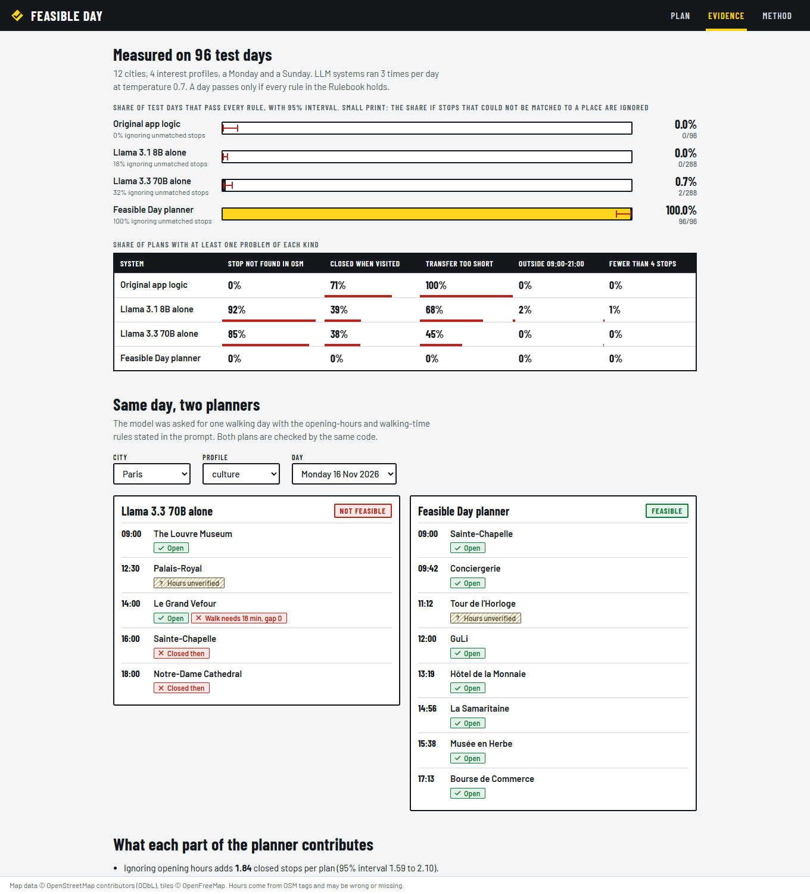

# Feasible Day

**Day plans you can actually walk.** Pick a city, interests and a date. Every stop is a real OpenStreetMap place, every time slot is checked against that place's opening hours, every transfer is checked against walking time, and the app shows which checks passed.

**Live:** https://brejbala-feasible-day.static.hf.space (free static hosting, no cold start, see [limits](#live-app-and-free-tier-limits)) · Space page: https://huggingface.co/spaces/BrejBala/feasible-day


## The problem

Ask a language model for a day in a city and you get fluent text with tidy times. Whether you can *do* that day is a different question, and one the model cannot check from memory:
the venue may be closed on that weekday, the walk may not fit in the gap, the place may not exist. Published evidence: [TravelPlanner (ICML 2024)](https://arxiv.org/abs/2402.01622) reports GPT-4 passing all constraints on 0.6% of tasks in its hardest setting, and an [agency test of ChatGPT-3.5](https://travolution.com/news/marketing/survey-finds-chatgpt-itineraries-to-be-riddled-with-inaccuracies) (not peer reviewed, old model) found 52% of itineraries sent people to venues outside opening hours. Details and caveats: [`docs/PROBLEM.md`](docs/PROBLEM.md).

This repo started as a generic "LLM travel guide" Streamlit app with no evidence it worked. It is rebuilt around that one measurable problem.

## What I measured first

A rulebook was fixed **before any planner code existed** ([`docs/PREREGISTRATION.md`](docs/PREREGISTRATION.md)): 96 test days (12 cities x 4 interest profiles x a Monday and a Sunday), a *feasible day* needs at least 4 stops, every stop a mapped place, none closed when visited, every transfer fitting the walking time, all inside 09:00 to 21:00, no venue twice. Thresholds were written down too. Amendments made later, and why, are listed at the bottom of that file.

| System | Days passing every rule | 95% interval | Passing if unmatched stops are ignored | Mean stops | Detour ratio (1.00 = shortest walk) |
| --- | --- | --- | --- | --- | --- |
| Original app logic (re-implemented) | 0 of 96 | 0 to 3.8% | 0% | 6.0 | 1.52 |
| Llama 3.1 8B alone, 3 runs per day | 0 of 288 | 0 to 1.3% | 17.7% (13.7 to 22.5) | 7.2 | 1.45 |
| Llama 3.3 70B alone, 3 runs per day | 2 of 288 | 0.2 to 2.5% | 31.6% (26.5 to 37.2) | 6.3 | 1.38 |
| **Feasible Day planner** | **96 of 96** | **96.2 to 100%** | 100% | 8.0 | 1.14 |



The LLM prompt states the opening-hours and walking-time requirements in plain words, so this is not a strawman ([`eval/llm.ts`](eval/llm.ts)). Models: `meta-llama/Llama-3.3-70B-Instruct` and `meta-llama/Llama-3.1-8B-Instruct` through Hugging Face Inference Providers, temperature 0.7. Stored outputs are in `data/llm/`, so every number reproduces without a token.

**Where the language models fail, among plans where stops could be placed:**

| | Plans with a closed stop | Plans with a transfer that does not fit | Stops closed when visited (of stops with known hours) |
| --- | --- | --- | --- |
| Llama 3.1 8B | 39% | 68% | 31% |
| Llama 3.3 70B | 38% | 45% | 27% |
| Original app logic | 71% | 100% | 48% |
| Planner | 0% | 0% | 0% |

**Ablations (planner without one part).** Ignoring opening hours: 15.6% of days stay feasible, with 1.84 more closed stops per plan (95% bootstrap interval 1.59 to 2.10). Skipping route ordering: detour ratio rises from 1.14 to 1.81 (+0.67, interval 0.60 to 0.74) with 10.3 km walked instead of 1.8 km.

Pre-registered thresholds: H1 (LLM-only mostly infeasible) met, also when unmatched stops are ignored. H2 (planner at least 95%, lower bound at least 90%) met on the shared rulebook, see the independent check below. H3 (not winning by doing less: at least 6 stops, 80% on profile, detour 1.15 or less) met. H4 (each part matters) met.

## What did not hold up, and the limits

- **"Not found" is not "hallucinated".** About a third of the LLM stops could not be matched to OpenStreetMap, but a read of a seeded sample (one reader, no live lookups) of 45 ([`results/not-found-spot-check.md`](results/not-found-spot-check.md)) found about 27 real venues my matcher missed, about 16 generic activities ("a traditional English pub", "Seine River Walk") and none confirmed invented. So no hallucination rate is claimed. That is why the table has a second column. Early in the project the first version of this metric said 95% of LLM plans had an ungrounded stop; that was a snapshot-coverage artefact, and the metric was changed (amendment 1).
- **The planner passes its own rulebook by construction.** The independent check re-times every planner transfer with routed foot durations from OSRM ([`results/osrm-check.json`](results/osrm-check.json)): 664 of 672 transfers fit (98.8%) and **91 of 96 plans (94.8%) have every transfer fitting**, just under the 95% threshold. The misses are Paris plans where a river or barrier makes the real walk up to 11 minutes longer than estimated. The walking model itself is within 10% mean absolute error of routing on 300 random pairs (median ratio 0.95, 12% of pairs underestimated by more than 20%), after the detour factor was raised from 1.3 to 1.37 ([`results/walk-calibration.json`](results/walk-calibration.json)).
- **Opening-hours data is thin.** Only 14% to 34% of sights, museums, parks and monuments in the snapshots carry a parseable `opening_hours` tag (restaurants excluded: they were selected for having one). About 41% of planner stops are therefore shown as *hours unverified*. Per city: [`results/hours-coverage.json`](results/hours-coverage.json). Mumbai is a deliberate stress case with only 29 sights; the app says when it cannot build a day.
- **Holiday rules are approximate.** opening_hours.js rejects public-holiday and school-holiday clauses without a calendar for the country and state. Those clauses are dropped (`approx`), so a visit on an actual public holiday can be wrong. The two test dates were chosen to avoid holidays, not verified for every region.
- **Importance is a proxy.** OpenStreetMap has no ratings. Importance is a hand-set category score plus a Wikidata-link bonus, and restaurants are chosen by position and tagged hours, not by taste. Weights were adjusted after looking at Paris and London plans, not tuned on evaluation scores.
- **Single rater, two models, one prompt.** The LLM baseline is two open models and one prompt. Other models or prompting (for example tool calls to a maps API) may do better; that is not tested here.

## Added cities: an out-of-sample check, and where it is weaker

After the thresholds were fixed and the 96-day run was done, 15 places were added: Tamil Nadu (Chennai, Madurai), Kerala (Ernakulam, Fort Kochi, Thiruvananthapuram), Bengaluru, Hyderabad, Pune, Kyoto, Osaka, Seoul, Busan, Beijing, Shanghai and Xi'an (pre-registration amendment 6). They are scored separately (120 test days) and nothing in the planner was changed after seeing them. No LLM baselines were run there, so H1 is not re-tested.

| 120 days in the 15 added cities | Days passing every rule | 95% interval | Mean stops | Stops with unverified hours |
| --- | --- | --- | --- | --- |
| Original app logic | 0 of 120 | 0 to 3.1% | 5.9 | 64% |
| Planner, hours ignored | 49 of 120 | 32.5 to 49.8% | 8.0 | 59% |
| Planner, no routing | 106 of 120 | 81.4 to 92.9% | 7.8 | 50% |
| **Feasible Day planner** | **120 of 120** | **96.9 to 100%** | 8.0 | 59% |

That pass rate is against the planner's own rulebook. The independent routing check ([`results/osrm-check-extension.json`](results/osrm-check-extension.json)) is much weaker than in the first 12 cities: **71 of 120 plans (59%)** have every transfer fitting routed walking time (766 of 834 transfers, 92%), against 94.8% of plans before. It is not uniform: Kyoto, Osaka, Seoul, Bengaluru and Fort Kochi pass every transfer; Hyderabad passes 32 of 56 transfers, with some walks 47 minutes longer than estimated; Chennai, Ernakulam, Pune, Beijing and Xi'an each pass 50 or 48 of 56. Likely causes (not tested): rivers, rail lines and ring roads that a straight-line model cannot see, and sparse sight data forcing longer hops (Madurai has 10 sights in the snapshot, Hyderabad 15, Pune 21). Opening hours are thinner too: 2% to 29% of sights carry a parseable tag, 59% of planner stops are unverified, and Busan has 2%.

The walking factor (1.37) was calibrated on the original 12 cities and is deliberately left alone. A per-city calibration is the obvious next step, but it would need its own held-out check. The app labels these cities as added and says so on the plan page.

## How it works

1. A snapshot of notable places from OpenStreetMap (Overpass API) for 27 city centres (the 12 pre-registered ones plus 15 added later), committed in `data/snapshots/` (ODbL).
2. A planner anchors the day on the densest cluster of important places, fixes lunch (and dinner on food days) in meal windows, then inserts stops one at a time by importance per extra walking minute, simulating the whole day (opening hours for the date, walking time, 21:00 limit) for every insertion.
3. A verifier ([`src/core/verify.ts`](src/core/verify.ts)) is the single definition of feasibility, used by the planner tests, the evaluation, and the in-app Rulebook panel.
4. The app is static React: everything runs in the browser, there is no server and no key. Architecture notes: [`docs/ARCHITECTURE.md`](docs/ARCHITECTURE.md). Design system: [`DESIGN.md`](DESIGN.md).

The interface is built around the thing a walker already trusts: trail signposts. Each transfer is a yellow signpost arm with the destination and walking minutes; hours that were checked are solid, hours that were not are hatched. The Evidence tab puts the numbers above in the product, with a side-by-side of the same day from the model and from the planner.

## Monthly update and city requests

- **News notices.** Once a month a job fetches recent headlines per city from GDELT and an LLM (through an OpenAI-compatible endpoint, with fallbacks and a hard monthly budget of $1.50, stopping at 80%) picks the few that matter to a walker: closures, strikes, festivals, severe weather. They appear as an "In the news" box with the source link, labelled *not verified*. They never change a plan. The URL and date are copied from the article by code, so the model cannot invent a source. The news feed throttles hard, so some cities are skipped in a run; each city shows its own check date and the stalest cities go first next time.
- **City requests.** The Request tab opens a prefilled GitHub issue (no backend, no stored personal data beyond the issue itself). The same job compiles open requests into [`docs/REQUESTS.md`](docs/REQUESTS.md): demand, geocoded point, number of sights within 3.5 km, and a ready line for `src/core/cities.ts`. Nothing is added automatically; a person reviews it.
- Runs on a schedule in `.github/workflows/monthly.yml` and opens a pull request. Details, secrets and costs: [`docs/OPERATIONS.md`](docs/OPERATIONS.md).

## Run it

```bash
npm ci
npm run dev            # app at http://localhost:5173
npm test               # 19 tests
npm run build
```

Reproduce the evaluation (offline, from stored model outputs and cached geocoder lookups):

```bash
npm run eval           # writes results/ and public/evidence.json
```

Re-collect data (needs network; the public Overpass server is slow and busy):

```bash
npm run data           # city snapshots
npm run eval -- --llm --reps 3     # LLM baselines, needs HF_TOKEN or `hf auth login`
npm run calibrate      # walking-time model vs OSRM
npm run osrm-check     # independent re-timing of planner transfers
npm run ops:smoke      # one tiny LLM call through the monthly job's client (needs .env)
npm run monthly        # notices + city-request digest
```

Configuration: `LLM_70B`, `LLM_8B` (baseline model ids), `LLM_ENDPOINT`, `VITE_MAP_STYLE` (basemap style URL). Free catalogs change, so none of these are hard-coded into logic. The monthly job has its own variables, see [`docs/OPERATIONS.md`](docs/OPERATIONS.md).

## Live app and free-tier limits

- Hosted as a **static Hugging Face Space** (free). No server, so no cold start and no quota to run out; first load fetches one city snapshot (about 150 to 400 KB).
- Verified live from `main` on 2026-11-01: plan, map, Evidence tab. On first load the map can take about 10 seconds to appear (vector style, fonts and worker download); the plan and Rulebook show immediately.
- Basemap: OpenFreeMap vector tiles (free, no key, third-party service with no uptime guarantee). If it is unreachable the timeline and Rulebook still work, only the map pane is blank.
- The app calls no LLM. LLM outputs appear only as stored baseline plans in the Evidence tab.
- Deploy: `npm run build` then `uvx --from huggingface_hub python scripts/deploy_hf.py BrejBala/feasible-day`. `.github/workflows/deploy.yml` does this on push to `main` when a write token is set as the repository secret `HF_TOKEN`.

## Data and licences

Map data © OpenStreetMap contributors, [ODbL](https://www.openstreetmap.org/copyright). Basemap © OpenFreeMap and OpenMapTiles. Snapshots and `data/geocode-cache.json` are derived from OpenStreetMap and carry the same licence. Code: MIT (see `LICENSE`).
