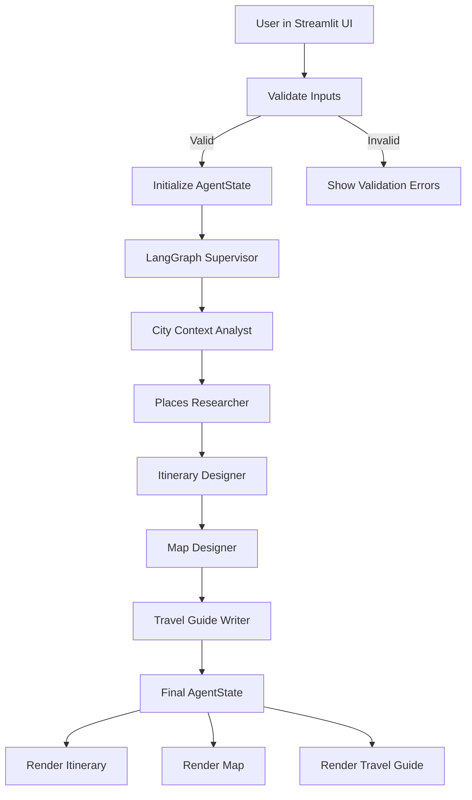

# System Architecture

## Overview

The City Travel Microguide application is a **Streamlit front-end** backed by a
**LangGraph-based multi-agent orchestration layer**. It integrates with
external APIs (Groq, OpenTripMap, Google Places) to generate a personalized
city guide consisting of:

- A day-by-day itinerary.
- A set of curated places with metadata.
- An interactive Folium map.
- A narrative travel guide.

This document describes the **high-level architecture**, **agent roles**, and
**data flow** from user input to final outputs.

---

## High-Level Components

- **Streamlit UI (`app.py`)**
  - Presents form inputs in the sidebar.
  - Displays itinerary, map, and travel guide.
  - Handles input validation and user-facing error messages.
  - Orchestrates calls into the LangGraph supervisor.

- **LangGraph Supervisor (`src/agents/supervisor.py`)**
  - Owns the shared `AgentState` typed dictionary.
  - Defines the graph of five agents (to be implemented in Prompt 2).
  - Compiles and runs the graph to produce a final state.

- **Agents (`src/agents/`)**
  - `BaseAgent` class defines the contract for all agents.
  - Five specialized agents (to be added):
    1. City Context Analyst
    2. Places Researcher
    3. Itinerary Designer
    4. Map Designer
    5. Travel Guide Writer

- **Tools (`src/tools/`)**
  - Encapsulate all external API calls and utility routines, e.g.:
    - OpenTripMap place search.
    - Google Places text/nearby search.
    - Any supporting geocoding logic.
  - Keep agents focused on reasoning while tools handle IO.

- **Utilities (`src/utils/`)**
  - `config.py`: Environment-driven configuration and Pydantic validation.
  - `logger.py`: Centralized logging configuration (console + file).
  - `validators.py`: Input validation and normalization for UI fields.
  - `prompts.py`: System prompts for each agent.

- **Constants (`src/constants/`)**
  - `categories.py`: Shared interest and place categories.

- **Context Docs (`context/`)**
  - `PROJECT_GOAL.md`, `ARCHITECTURE.md`, `IMPLEMENTATION_LOG.md`:
    - Living documentation to keep design and implementation aligned.

---

## Data Model: AgentState

The **AgentState** is a `TypedDict` that captures the entire shared state passed
between agents in the LangGraph workflow.

Key fields:

- `city: str`
- `days: int`
- `transportation: str`
- `interests: list[str]`
- `budget: str`
- `advanced_preferences: dict[str, Any]`
- `places: list[dict[str, Any]]`
- `itinerary: list[dict[str, Any]]`
- `travel_guide: str`
- `map_data: dict[str, Any]`
- `errors: list[str]`

This state is:

- **Initialized** from the validated user preferences in `app.py`.
- **Augmented** step-by-step by each agent.
- **Consumed** by the UI to render the final outputs.

---

## Planned Agent Responsibilities

The five-agent design keeps each component focused and testable.

### 1. City Context Analyst

- Input:
  - Raw user preferences (`city`, `days`, `transportation`, `interests`, `budget`, `advanced_preferences`).
- Responsibilities:
  - Interpret travel style and constraints.
  - Identify neighborhoods/zones relevant to the user.
  - Infer missing details (e.g., pace, time of day preferences).
- Output:
  - Enriched metadata on the city and user profile.
  - Guidance for downstream agents via structured notes in `AgentState`.

### 2. Places Researcher

- Input:
  - Enriched user profile and city context from the analyst.
- Responsibilities:
  - Call tools that wrap:
    - OpenTripMap for broad coverage of POIs.
    - Google Places for richer details and coverage.
  - Filter and rank places based on interests, budget, and location.
  - Deduplicate overlapping results across APIs.
- Output:
  - Curated list of candidate places stored in `state["places"]`.
  - Category tags, neighborhoods, and basic metadata.

### 3. Itinerary Designer

- Input:
  - Candidate places and user constraints.
- Responsibilities:
  - Group places into a **day-by-day** structure.
  - Ensure geographic coherence and realistic travel times.
  - Balance must-see highlights with local/hidden gems.
  - Annotate each day with a short summary.
- Output:
  - Structured itinerary stored in `state["itinerary"]`.

### 4. Map Designer

- Input:
  - Itinerary and places.
- Responsibilities:
  - Transform places and itinerary into a **map-friendly structure**.
  - Assign marker coordinates, labels, and categories.
  - Propose initial zoom/bounds and optional clustering.
- Output:
  - Map data stored in `state["map_data"]` ready for Folium rendering.

### 5. Travel Guide Writer

- Input:
  - Final itinerary and enriched place information.
- Responsibilities:
  - Produce a human-readable, inspiring travel guide.
  - Provide practical tips, ordering hints, and brief context for each stop.
- Output:
  - Narrative guide stored in `state["travel_guide"]`.

---

## Orchestration Flow

A conceptual view of the data flow:

The **LangGraph supervisor** will, in Prompt 2:

- Instantiate nodes for each agent.
- Define edges for the primary flow.
- Optionally introduce:
  - Error-handling branches.
  - Short-circuit paths when an upstream failure occurs.

For Prompt 1, the graph is intentionally minimal and simply passes the state
through while recording a message that agents are not yet active.

---

## Error Handling & Graceful Degradation

Error handling is layered:

1. **Input Validation (UI layer)**
   - Ensures that obviously invalid inputs are rejected early.
   - Errors are displayed via `st.error()` and do not crash the app.

2. **Configuration Validation (config layer)**
   - Validates presence and basic correctness of environment variables.
   - Exposes a non-crashing `try_load_config` helper for the UI.

3. **Agent/Tool Failures (agent layer, Prompt 2)**
   - Exceptions are caught and recorded into `state["errors"]`.
   - Downstream agents can choose to continue with partial data.
   - The UI can display warnings while still rendering best-effort results.

4. **Logging**
   - All unexpected errors are logged to:
     - `logs/app.log` (rotating file handler).
     - Standard output for debugging in Streamlit Cloud.

---

## Deployment Architecture

- **Runtime**: Streamlit Community Cloud (Python environment).
- **Frontend**: Streamlit app served from `app.py`.
- **Backend**: In-process Python code (no separate microservices).
- **External Services**:
  - Groq API for all LLM calls.
  - OpenTripMap and Google Places for place data.
- **Configuration**:
  - `.env` in local development.
  - Streamlit secrets or environment variables in production.

This simple deployment model keeps infrastructure overhead minimal while still
demonstrating a powerful, multi-agent AI application.