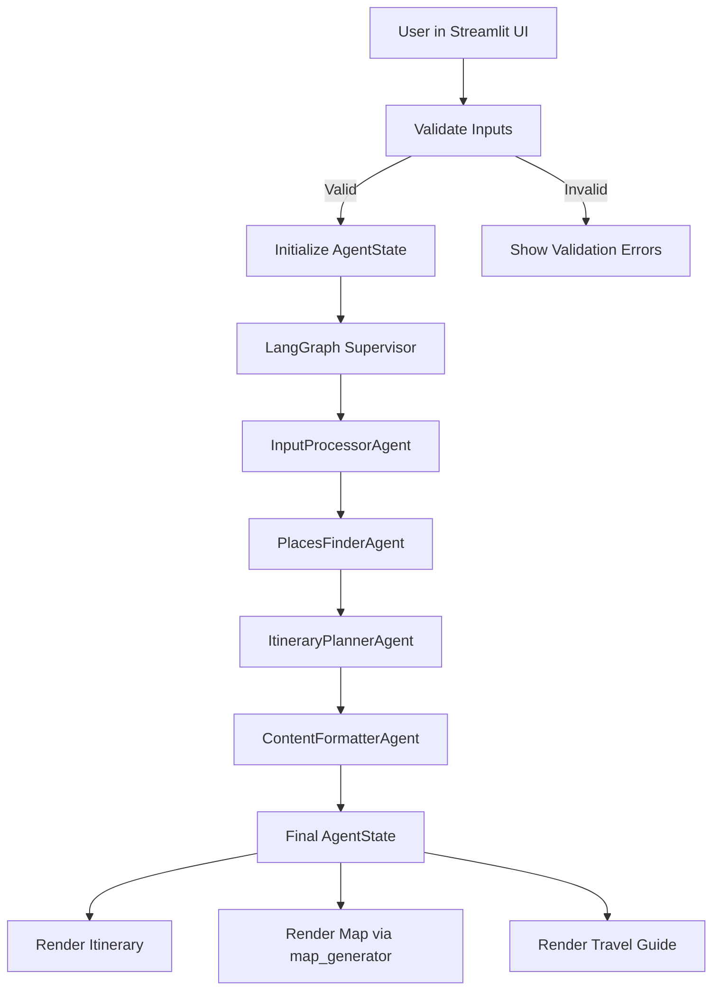

# System Architecture

## Overview

The City Travel Microguide application is a **Streamlit front-end** backed by a
**LangGraph-based multi-agent orchestration layer**. It integrates with
external APIs (Groq, OpenTripMap, Google Places, OpenStreetMap/Nominatim) to
generate a personalized city guide consisting of:

- A day-by-day itinerary.
- A set of curated places with metadata.
- An interactive Folium map.
- A narrative travel guide.

This document describes the **high-level architecture**, **agent roles**, and
**data flow** from user input to final outputs.

---

## High-Level Components

- **Streamlit UI (`app.py`)**
  - Presents form inputs in the sidebar.
  - Displays itinerary, map, and travel guide.
  - Handles input validation and user-facing error messages.
  - Orchestrates calls into the LangGraph supervisor.

- **LangGraph Supervisor (`src/agents/supervisor.py`)**
  - Owns the shared `AgentState` typed dictionary.
  - Defines the graph of four concrete agents plus the supervising workflow.
  - Compiles and runs the graph to produce a final state.

- **Agents (`src/agents/`)**
  - `BaseAgent` class (in `base_agent.py`) defines the contract for all agents.
  - Four specialised agents:
    1. `InputProcessorAgent` (`input_processor.py`)
    2. `PlacesFinderAgent` (`places_finder.py`)
    3. `ItineraryPlannerAgent` (`itinerary_planner.py`)
    4. `ContentFormatterAgent` (`content_formatter.py`)

- **Models (`src/agents/models.py`)**
  - Pydantic models used across agents:
    - `InputPreferences`
    - `TimeSlot`, `Day`, `ItineraryPlan`
    - `Place`, `PlacesList`

- **Tools (`src/tools/`)**
  - `geo_utils.py`
    - Geocoding via Nominatim (`geocode_city`) with hardcoded fallbacks.
    - City bounding box calculation (`get_city_bounds`).
  - `places_api.py`
    - OpenTripMap search for attractions and shopping.
    - Google Places search for restaurants.
    - Hardcoded fallback places for major cities.
  - `map_generator.py`
    - Folium map generation with colour-coded markers from `PlacesList`.

- **Utilities (`src/utils/`)**
  - `config.py`: Environment-driven configuration and Pydantic validation.
  - `logger.py`: Centralised logging configuration (console + file).
  - `validators.py`: Input validation and normalization for UI fields.
  - `prompts.py`: System prompts for each agent and orchestration task.

- **Constants (`src/constants/`)**
  - `categories.py`: Shared interest and place categories.

- **Context Docs (`context/`)**
  - `PROJECT_GOAL.md`, `ARCHITECTURE.md`, `IMPLEMENTATION_LOG.md`:
    - Living documentation to keep design and implementation aligned.

---

## Data Model: AgentState

The **AgentState** is a `TypedDict` that captures the entire shared state passed
between agents in the LangGraph workflow.

Key fields:

- Raw inputs (from UI):
  - `city: str`
  - `days: int`
  - `transportation: str`
  - `interests: list[str]`
  - `budget: str`
  - `advanced_preferences: dict[str, Any]`

- Derived structured data:
  - `preferences: dict[str, Any]` — serialised `InputPreferences`.
  - `city_info: dict[str, Any]` — result of `geocode_city`.
  - `places_list: dict[str, Any]` — serialised `PlacesList`.
  - `places: list[dict[str, Any]]` — flattened list of all places.
  - `itinerary_plan: dict[str, Any]` — serialised `ItineraryPlan`.
  - `itinerary: list[dict[str, Any]]` — simplified day summaries for UI.

- Final outputs:
  - `travel_guide: str` — Markdown travel guide.
  - `map_data: dict[str, Any]` — reserved for future map metadata.

- Diagnostics:
  - `errors: list[str]` — non-fatal issues encountered during processing.

This state is:

- **Initialised** from the validated user preferences in `app.py`.
- **Augmented** step-by-step by each agent.
- **Consumed** by the UI to render the final outputs and map.

---

## Agent Responsibilities

The design uses four concrete agents plus the LangGraph supervisor as the
coordinating “fifth agent”.

### 1. InputProcessorAgent (`input_processor.py`)

- Input:
  - Raw fields from `AgentState` (`city`, `days`, `transportation`, `interests`, `budget`, `advanced_preferences`).
- Responsibilities:
  - Construct and validate an `InputPreferences` model.
  - Geocode the city via `geocode_city` (Nominatim + hardcoded fallbacks).
  - Optionally call Groq with a lightweight prompt to sanity-check the inputs.
- Output:
  - `state["preferences"]` — serialised `InputPreferences`.
  - `state["city_info"]` — geocoding result.
  - Appends advisory messages to `state["errors"]` when appropriate.

### 2. PlacesFinderAgent (`places_finder.py`)

- Input:
  - Normalised `preferences` and `city_info`.
- Responsibilities:
  - Decide, using Groq tool/function-calling, which logical tools to execute:
    - `search_attractions` → OpenTripMap (via `search_attractions_opentripmap`).
    - `search_restaurants` → Google Places (via `search_restaurants_google_places`).
    - `search_shopping` → OpenTripMap (via `search_shopping_areas`).
  - Perform the corresponding API calls using `src/tools/places_api.py`.
  - Apply hardcoded fallbacks when APIs are unavailable or return no data.
  - Ensure a reasonably rich set of places (aiming for 30+).
- Output:
  - `state["places_list"]` — serialised `PlacesList`.
  - `state["places"]` — flattened list of all places for convenience.
  - Non-fatal issues (e.g., fallback usage) appended to `state["errors"]`.

### 3. ItineraryPlannerAgent (`itinerary_planner.py`)

- Input:
  - Normalised `preferences`.
- Responsibilities:
  - Build a deterministic baseline itinerary of `ItineraryPlan`:
    - One `Day` per trip day.
    - Each day with `TimeSlot`s for morning, afternoon, and evening.
  - Optionally use Groq (text-only call) to generate high-level itinerary notes
    describing pacing and structure.
- Output:
  - `state["itinerary_plan"]` — serialised `ItineraryPlan`.
  - `state["itinerary"]` — simplified list of days for display in Streamlit.

### 4. ContentFormatterAgent (`content_formatter.py`)

- Input:
  - `preferences`, `itinerary_plan`, `places_list`, and optional `city_info`.
- Responsibilities:
  - Call Groq with a detailed prompt to generate a Markdown travel guide.
  - If the call fails, fall back to a template-based Markdown generator.
  - Keep the guide concise, structured, and mobile-friendly.
- Output:
  - `state["travel_guide"]` — Markdown travel guide string.
  - Adds explanatory error when the fallback template is used.

---

## Tools Layer

### Geocoding (`src/tools/geo_utils.py`)

- `geocode_city(city: str) -> dict | None`
  - Uses OpenStreetMap Nominatim to resolve city names to coordinates.
  - Respects polite rate limiting (1 req/second).
  - Falls back to a small set of hardcoded city coordinates when necessary.
- `get_city_bounds(city_info: dict) -> dict`
  - Converts Nominatim bounding boxes into a canonical `{north, south, east, west}` format.

### Places APIs (`src/tools/places_api.py`)

- `search_attractions_opentripmap(config, city, lat, lon, limit=40) -> list[Place]`
  - Uses OpenTripMap to find attractions and landmarks near the city centre.
- `search_shopping_areas(config, city, city_info, limit=20) -> list[Place]`
  - Uses OpenTripMap to find markets, shopping malls, and commercial streets.
- `search_restaurants_google_places(config, city, lat, lon, limit=30) -> list[Place]`
  - Uses Google Places to find nearby restaurants when an API key is configured.
- `fallback_places_for_city(city) -> list[Place]`
  - Provides a small curated list of landmarks for major cities when APIs fail.

### Map Generation (`src/tools/map_generator.py`)

- `create_map(places_data: dict, city_info: dict | None) -> folium.Map`
  - Parses a `PlacesList` dict and produces a Folium map.
  - Determines the map centre from `city_info` or the average of place coordinates.
  - Uses colour-coded circle markers:
    - Attraction: `#0066cc` (blue)
    - Restaurant: `#cc0000` (red)
    - Shopping: `#00cc00` (green)
    - Hotel: `#ffcc00` (yellow)
    - Other: grey
  - Popups show name, type, optional rating, and address.

The Streamlit app embeds this map using `streamlit-folium`.

---

## Orchestration Flow

A conceptual view of the data flow:

The LangGraph supervisor:

- Instantiates all agents with shared `AppConfig`.
- Defines a sequential flow:
  - `entry -> input_processor -> places_finder -> itinerary_planner -> content_formatter -> END`.
- Ensures that `errors` are accumulated in `AgentState` rather than raising
  unhandled exceptions.

---

## Error Handling & Graceful Degradation

Error handling is layered:

1. **Input Validation (UI layer)**
   - Ensures that obviously invalid inputs are rejected early.
   - Errors are displayed via `st.error()` and do not crash the app.

2. **Configuration Validation (config layer)**
   - Validates presence and basic correctness of environment variables.
   - Exposes a non-crashing `try_load_config` helper for the UI.

3. **Agent/Tool Failures (agent layer)**
   - Each agent catches its own errors and appends messages to `state["errors"]`.
   - External API and Groq failures are logged and converted into fallbacks
     (hardcoded data, template-based guides, or partial results).
   - The UI can display warnings while still rendering best-effort results.

4. **Logging**
   - All unexpected errors are logged to:
     - `logs/app.log` (rotating file handler).
     - Standard output for debugging in Streamlit Cloud.

---

## Deployment Architecture

- **Runtime**: Streamlit Community Cloud (Python environment).
- **Frontend**: Streamlit app served from `app.py`.
- **Backend**: In-process Python code (no separate microservices).
- **External Services**:
  - Groq API for all LLM calls (input processor, itinerary notes, content formatter, places decider).
  - OpenTripMap and Google Places for place data.
  - OpenStreetMap/Nominatim for geocoding.
- **Configuration**:
  - `.env` in local development.
  - Streamlit secrets or environment variables in production.

This architecture keeps infrastructure overhead minimal while still
demonstrating a powerful, multi-agent AI application with external API
integration and rich map-based output.